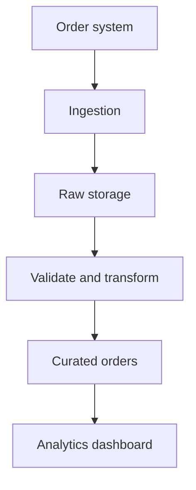

# F00.01 — Worked Examples

## Event grain versus order grain

| event_id | order_id | status |
|---|---|---|
| E01 | O201 | created |
| E02 | O201 | completed |
| E03 | O202 | created |
| E04 | O201 | refunded |

There are **four events** and **two distinct orders**. `order_id` is not unique at event grain. `event_id` is unique in this example.

## Example data flow

### Thinking sequence
1. Identify source and grain.
2. Confirm whether events are unique or retries.
3. Define business rules for completed, cancelled, and refunded states.
4. Produce curated order-level data without overwriting the audit trail.
5. Reconcile the final metric with source data.
